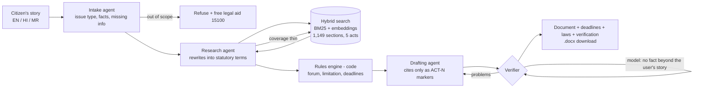

# NyayaSathi — agentic legal aid for every Indian

> *Nyaya* (न्याय) = justice, *Sathi* (साथी) = companion. Describe your problem in English, Hindi or Marathi;
> NyayaSathi's agents find the exact sections of Indian law, a rules engine works out the right forum and deadlines,
> and you get a ready-to-file complaint in which **every citation is checked against the statute text and every
> fact against your own words**.

**Live demo:** {{LIVE_URL}} · Built by [Shravan Kasar](https://github.com/shravankasar37)

---

## The problem

India has over five crore pending court cases and very few lawyers per citizen outside the big cities. Yet most
everyday legal problems do not need a court case at all, they need **the right document sent to the right
authority before the deadline**:

- a shop sells a defective phone and refuses to replace it → a consumer complaint to the District Commission
- a municipal office will not say how road money was spent → an RTI application
- the police refuse to register an FIR for a stolen bike → a written complaint, then the SP, then the Magistrate
- a fake "bank officer" empties an account → 1930, cybercrime.gov.in and an FIR, within hours

People lose these because they do not know which law applies, which office to approach, or how to write it, and a
lawyer for a ₹18,000 phone is not an option. Generic chatbots make it worse: they cite repealed IPC sections,
invent section numbers, and add facts that never happened, which can sink a real complaint.

## What NyayaSathi does



**Design rule: the model reads and drafts; code decides.** Which commission has jurisdiction, the two-year
limitation, the 30-day RTI clock and the FIR escalation path come from a tested rules engine, never from the LLM,
and every rule names the section or subordinate rules it comes from.

### Agents

| Agent | Job | Guardrails |
|---|---|---|
| **Intake** | Classifies the issue (consumer, RTI, RTI appeal, police, cyber fraud, out of scope), extracts dates, amounts, parties, place | Never invents facts; asks only when the legal problem itself is unclear; refuses out-of-scope matters instead of guessing |
| **Research** | Rewrites the citizen's words into statutory vocabulary, runs hybrid retrieval, selects applicable sections **only from what was retrieved**, searches again if coverage is thin | Cannot cite from memory; procedural sections for the issue are always attached by code |
| **Rules engine** (code) | Forum by value (2021 Jurisdiction Rules), limitation (CPA s.69), appeal window (s.41), RTI reply/appeal deadlines (s.7, s.19), FIR escalation (BNSS s.173, s.175), 1930 for cyber fraud | Unit-tested; a test checks each statute really contains the period the rule uses |
| **Drafting** | Writes the complete formal document with `[[ACT-N]]` citation markers and `[placeholders]` | Only researched markers allowed; rules are advice, never written as things the user already did |
| **Verification** | Code: every marker exists and was researched, no loose section numbers. Model: the cited section's text supports each sentence; no statement of fact goes beyond the user's story | Failures go back to the drafter once; what remains is shown to the user as "check this" |

## Results

### Retrieval (40 citizen questions, incl. Hindi and Marathi)

Every gold label is checked automatically against the section's real text before scoring
([`evals/retrieval.json`](evals/retrieval.json), [`scripts/eval-retrieval.ts`](scripts/eval-retrieval.ts)).

| Retriever | R@1 | R@3 | R@5 | R@10 | MRR@10 |
|---|---|---|---|---|---|
| BM25 only | 27.5% | 47.5% | 50.0% | 57.5% | 0.381 |
| Embeddings only (multilingual-e5) | 45.0% | 57.5% | 67.5% | 75.0% | 0.545 |
| Hybrid (RRF) | 42.5% | 65.0% | 75.0% | 82.5% | 0.560 |
| **Hybrid + research-agent query rewriting** | **45.0%** | **82.5%** | **90.0%** | **97.5%** | **0.652** |

Query rewriting is what turns "a man snatched my gold chain" into *snatching*, "damaged my car" into *mischief*
and "pretended to be a bank officer" into *cheating by personation*. The rewrite prompt contains no terms from the
test set ([`scripts/eval-rewrite.ts`](scripts/eval-rewrite.ts)).

### End-to-end

{{E2E_TABLE}}

### Rules engine

`npm test`: forum thresholds (₹50 lakh / ₹2 crore boundaries), limitation across a leap day, RTI deadlines, cyber
fraud ordering, and **14 statute-text checks** (e.g. CPA s.41 contains "forty-five days", RTI s.19 "ninety days",
BNSS s.173 "irrespective of the area").

## Why this is built the way it is

- **Agentic RAG, measured:** the research agent lifts recall@5 from 75% to 90% over plain hybrid search.
- **Grounding you can audit:** citations are markers resolved by code against a verified corpus; the user can open
  every cited section's full text and the official PDF.
- **Hallucination defence in depth:** retrieval-only citations, code checks, an entailment check per citation and
  a fact-faithfulness check against the user's own story, with a revise loop.
- **Responsible scope:** it refuses family, property, tenancy and employment matters rather than guessing, and
  points to free legal aid (NALSA 15100).
- **Runs at ₹0:** Gemini free tier with a model fallback chain (overloaded or rate-limited models fail over),
  BM25-only retrieval if the embedding service is down, and **recorded runs** so the demo works even when the day's
  free quota is used up.

## Corpus

| Act | Sections | Covers |
|---|---|---|
| Bharatiya Nyaya Sanhita, 2023 | 358 | offences (theft, cheating, threats, assault…), replaced the IPC |
| Bharatiya Nagarik Suraksha Sanhita, 2023 | 531 | FIR, investigation, bail, replaced the CrPC |
| Consumer Protection Act, 2019 | 107 | consumer complaints, commissions, product liability |
| Right to Information Act, 2005 | 31 | RTI applications, appeals, penalties |
| Information Technology Act, 2000 | 122 | cyber offences (66C identity theft, 66D cheating by personation…) |

Official text from the Gazette copies hosted by PRS Legislative Research; parsed one record per section with a
parser that enforces section order and reports gaps ([`scripts/ingest.ts`](scripts/ingest.ts)).

## Run it locally

```bash
npm install
cp .env.example .env.local        # add a free Gemini API key from aistudio.google.com/apikey
npm run build && npm start        # http://localhost:3000
```

Retrieval works offline with `EMBED_PROVIDER=local` (multilingual-e5-small, int8 ONNX). Scripts:
`npm test` (rules), `npm run eval:retrieval`, `node --env-file=.env.local --import tsx scripts/eval-rewrite.ts`,
`npm run eval` (end to end), `node --env-file=.env.local --import tsx scripts/record.ts` (record example runs).

## Deploy (free)

Render free web service from [`render.yaml`](render.yaml) + [`Dockerfile`](Dockerfile); set `GEMINI_API_KEY` in
the Render dashboard. The server uses Gemini embeddings in production to stay inside 512 MB.

## Limits

NyayaSathi gives legal information and drafts, not legal advice. It covers five central acts; state rules, court
fees and recent amendments may differ. Recorded runs are real outputs saved from the live agents and are labelled
as recordings in the UI.
